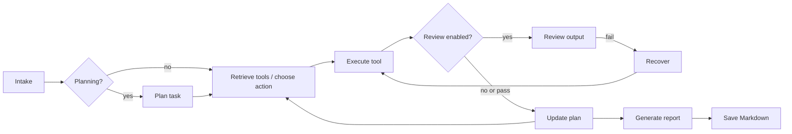

# AutoAnalyst

AutoAnalyst is a tool-using business analysis agent. It accepts a natural-language question, inspects a SQLite dataset, runs read-only SQL, performs Python/pandas analysis and creates PNG charts, then saves a Markdown report. The workflow is orchestrated by LangGraph and works offline with its deterministic FakeLLM. The configured LLM provider can be OpenAI/OpenAI-compatible, Anthropic, or an OpenCode V2 server.

## Architecture



The run directory is `output/runs/<run-id>/` and contains `state.json`, `trace.jsonl`, `metrics.json`, `final_report.md`, `charts/`, `reports/`, and `intermediate/`. The SQL tool uses a read-only SQLite connection and only accepts one SELECT/WITH query. Python executes in a timed subprocess with a minimal environment; this is process isolation, not a hardened OS/container security boundary. Do not use the Python tool with untrusted code in a multi-tenant environment.

## Dataset

The primary data is the [UCI Online Retail dataset](https://github.com/ratharin1223-lab/UCI-online-Retail-Dataset), originally published by Daqing Chen via UCI (CC BY 4.0; the linked repository is MIT-licensed). Attribution and transformation details are in [`data/SOURCES.md`](data/SOURCES.md). `sales_facts` maps invoice date, stock code/description, quantity, unit price, and customer country to the common analytical view. It retains all source rows, including negative quantities and cancellation invoices; line revenue is quantity × unit price in GBP. The data contains no product categories, costs, or sub-country regions.

The raw workbook and generated SQLite database are excluded from version control. Fetch and prepare them with:

```bash
python scripts/fetch_dataset.py
python scripts/prepare_dataset.py
```

## Setup

Requires Python 3.11 or newer.

```bash
python -m venv .venv
# Windows PowerShell: .venv\Scripts\Activate.ps1
# macOS/Linux: source .venv/bin/activate
python -m pip install -e ".[dev]"
Copy-Item .env.example .env  # PowerShell; optional
```

By default no API key is needed (`AUTOANALYST_LLM_PROVIDER=fake`). Choose a provider in `configs/default.yaml` (`llm_provider`) or override it in `.env`:

```env
AUTOANALYST_LLM_PROVIDER=openai      # fake | openai | anthropic
OPENAI_API_KEY=...
OPENAI_BASE_URL=https://api.openai.com/v1
OPENAI_MODEL=gpt-4o-mini
```

For Anthropic, set `AUTOANALYST_LLM_PROVIDER=anthropic`, `ANTHROPIC_API_KEY`, and optionally `ANTHROPIC_MODEL` and `ANTHROPIC_BASE_URL`. Claude model IDs use strict JSON-schema outputs by default; non-Claude models behind a compatible proxy use prompt-constrained JSON by default. Override this with `ANTHROPIC_STRUCTURED_OUTPUTS=true|false` if needed. For an OpenAI-compatible gateway, select `openai` and set its base URL/token/model.

To use an OpenCode V2 server, set `AUTOANALYST_LLM_PROVIDER=opencode`, `OPENCODE_BASE_URL`, and (when server authentication is enabled) `OPENCODE_TOKEN` (sent as a Bearer token). Set `OPENCODE_MODEL=providerID/modelID` to select a model; otherwise the OpenCode server's configured default is used. This adapter calls OpenCode's **experimental stateless text-generation API** (`/api/experimental/generate/text`), asks the model for JSON, and validates that JSON in AutoAnalyst. The route does not expose sampling controls or token usage. `AUTOANALYST_LLM_MODEL` overrides provider-specific model settings; keep tokens in `.env`, never YAML or source control. `AUTOANALYST_DATASET` and `AUTOANALYST_OUTPUT` override local paths.

`llm_temperature` is applied to OpenAI requests. Anthropic's current Messages SDK request schema does not accept a `temperature` argument, so Anthropic uses the model/API default; OpenCode uses its server-side configuration.

## Demo

Uses real UCI product descriptions:

```bash
python -m autoanalyst.demo --query "Compare Q3 sales of WHITE HANGING HEART T-LIGHT HOLDER and WHITE METAL LANTERN, and show the best region."
```

Or use a config/mode explicitly:

```bash
python -m autoanalyst.demo --config configs/default.yaml --mode plan_with_review_and_retrieval --query "Top 5 products by revenue and chart the results."
```

The command prints a report path and chart paths. Both are persisted under the run directory.

## Workflow modes and experiments

| Mode | Upfront plan | Output review | Tool retrieval |
|---|---:|---:|---:|
| `react_baseline` | no | no | no |
| `plan_only` | yes | no | no |
| `plan_with_review` | yes | yes | no |
| `plan_with_review_and_retrieval` | yes | yes | yes |

Planning, review, and retrieval are separate configuration flags. Retrieval uses BM25-style lexical scoring and domain tag boosts; all-tools mode remains available for comparison.

The hypotheses are H1 (plan-first vs ReAct on longer workflows), H2 (whether output review reduces failures), and H3 (whether retrieval improves tool selection). The plan-first path has five sequential tool actions (schema, SQL, metric validation, chart, report), while the ReAct baseline can use the canonical view directly and takes fewer actions. Evaluation inputs in `eval/questions.json` use actual UCI product descriptions and countries. Since source categories do not exist, the evaluation substitutes country/product analysis rather than inventing categories. `eval/golden/checks.json` stores independent tolerance-based lifetime net revenue references in GBP. Artifact assertions and aggregate task-success, error-recovery, tool-selection, steps, tool calls, time, and token metrics are in `src/autoanalyst/evaluation/`. Each experiment YAML specifies both arms; paired JSON/Markdown summaries are written to `experiments/results/`:

```bash
python -m autoanalyst.evaluate --config configs/experiment_h1_plan_vs_react.yaml
python -m autoanalyst.evaluate --config configs/experiment_h2_output_review.yaml
python -m autoanalyst.evaluate --config configs/experiment_h3_tool_retrieval.yaml
# Fast smoke of the first two questions
python -m autoanalyst.evaluate --config configs/default.yaml --limit 2
```

For a controlled comparison, run each arm with the corresponding `--mode` (`react_baseline` vs `plan_only`, `plan_only` vs `plan_with_review`, or `plan_with_review` vs `plan_with_review_and_retrieval`) and compare the generated summaries. The offline FakeLLM is deterministic but is not evidence for the hypotheses; repeat with a configured model and report provider/model/temperature alongside results. Token metrics are zero/omitted where the provider does not return usage.

## Tests

```bash
pytest
```

Tests run without paid API credentials or internet. Dataset acquisition is the only optional network-dependent task.

## Troubleshooting

- **Dataset missing:** run `python scripts/fetch_dataset.py` and then `python scripts/prepare_dataset.py`. The fetch step downloads the pinned UCI workbook from the linked GitHub repository; preparation creates the SQLite database from all workbook rows.
- **No charts:** inspect `output/runs/<run-id>/errors.json`, `trace.jsonl`, and `charts/`; Python failures include a captured traceback.
- **LLM JSON problems:** critical outputs are Pydantic-validated and use deterministic fallbacks; check trace/error artifacts.
- **Result looks deterministic with a paid provider:** CLI prints the selected provider/model. Check the run's `metrics.json` for `llm_fallbacks` and `llm_fallback_details`; the report also warns when a provider call failed and deterministic fallback was used.
- **Provider not called:** check `AUTOANALYST_LLM_PROVIDER`, the corresponding API key/token, and provider-specific model/base URL settings. Missing OpenAI or Anthropic keys raise a configuration error rather than silently switching to FakeLLM.

## Known limitations

- The UCI dataset is a compact, one-year retail sample; `Country` is the only geographic field.
- The default deterministic agent uses a conservative query template and may not fully interpret arbitrary multi-part questions; evaluation task breadth does not imply perfect answer correctness.
- Product categories, profit/margin, sub-country regions, and fiscal-calendar handling are unsupported because the source has no corresponding fields. Revenue is in GBP, and cancellations/returns remain included as negative net adjustments.
- The Python runner limits time, environment variables, and outputs by convention but is not a hardened sandbox. Use container/OS isolation before executing untrusted generated code.
- Experiment arms should be run separately with a pinned model/config; this implementation does not claim H1/H2/H3 are empirically validated.
